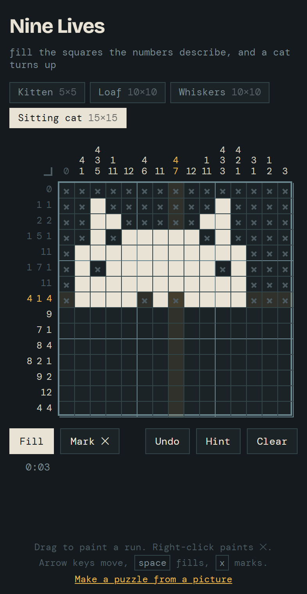

# Nonogram

> Written with [Claude](https://claude.ai), Anthropic's AI assistant — the game, the puzzle maker and this README.

**Play it:** https://bburns.github.io/nonogram/

**Nine Lives** — a nonogram (picross) puzzle game of pixel cats, in one self-contained HTML file.

Open `index.html` in a browser. No build, no server, no dependencies beyond two Google fonts.

## The puzzles

Four cats live in the `PUZZLES` array near the top of the script:

| Puzzle      | Size  |
| ----------- | ----- |
| Kitten      | 5×5   |
| Loaf        | 10×10 |
| Whiskers    | 10×10 |
| Sitting cat | 15×15 |

Each is an array of `#`/`.` strings; the row and column clues are derived at load, not stored. Adding a cat is a matter of appending N strings of length N.

## Puzzles from pictures

`make.html` turns a picture into a puzzle. Drop in a JPEG or PNG, pick a size, and adjust the threshold. **Add to the game** saves it in the browser and opens it in `index.html`; **Copy as code** gives the `PUZZLES` entry to paste in.

It crops to the subject, shrinks it by averaging, and splits light from dark at an automatic threshold. A thresholded picture usually can't be solved without guessing, so it then runs a solver that works the way a person does, one row or column at a time. Where the solver gets stuck, it changes the square that helps most, preferring squares whose shade was close to the threshold anyway. Changed squares show in gold. A finished puzzle has one answer and needs no guessing.

Silhouettes, icons and bold shapes on a plain background turn out best. A busy photo still comes out solvable, but at 15×15 it rarely looks like anything.

## Picking pictures

`../picscore` ranks folders of pictures for how good a nonogram they'd make, using `scorer.js` here. That file is a thin wrapper over `picture.js`, so a picture scores exactly as `make.html` would make it. The score's six parts are explained at the top of the quality section in `picture.js`. Its chooser page opens a picture here with `make.html?pic=<address>&name=<name>`.

## Controls

- **Drag** to paint a run. The first cell of the stroke decides whether the whole stroke fills or erases, and the stroke stays in the row or column it first moves along.
- **Right-click** (or the Mark tool) to cross a square off.
- **Arrow keys** move the cursor; **space** fills, **x** marks.
- **Hint** fills one correct square and adds 30 seconds to the clock.
- Completed rows and columns dim their own clue numbers.

## Notes on the implementation

Win detection compares the clues your grid generates against the puzzle's clues, rather than against the stored solution — so an alternate valid solution still counts as solved.

Best times and in-progress grids are saved through `window.storage` inside claude.ai, and `localStorage` everywhere else, so a half-finished puzzle survives a reload.

Puzzles stop at 15×15 on purpose. On a phone a 20×20 grid shrinks the cells and clues until they strain the eyes, which is the problem with most picross apps. Clues are drawn large and bright, and the current row and column are highlighted under your finger.

## Origin

Generated in a Claude conversation on 2026-09-14 — see `transcripts/2026-09-14.md`.
